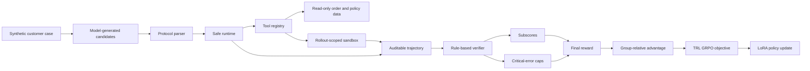

# Architecture

The public repository isolates five ideas that matter most in the full system: controlled execution, rollout-local state, auditable trajectories, grounded verification, and reward-driven model updates.



## Runtime boundary

`run_scenario` accepts a validated synthetic case and executes its plan through a fixed tool registry. The zero-dependency quick start uses deterministic plans. The public training experiment instead parses model-generated `<tool_call>` blocks and sends the resulting plans through the same runtime boundary.

## Rollout isolation

Each execution receives a namespace. All mutable writes carry that namespace and land in an in-memory sandbox. Order and policy records remain immutable. Two executions of the same case therefore cannot observe or mutate one another's side effects.

## Reliability behavior

Failure injection is scenario-controlled. The transient-failure scenario forces the first order lookup to time out, exercises bounded retry, and verifies that the eventual refund occurs exactly once.

## Safety behavior

Write tools are checked against a per-scenario allowlist before execution. A blocked action remains visible in the trajectory but creates no ledger entry. This makes the difference between attempted and executed behavior auditable.

## Verifier

The verifier calculates five subscores:

| Subscore | Weight | What it measures |
| --- | ---: | --- |
| Outcome | 0.45 | Required side effects and a completed response |
| Policy | 0.20 | Required policy lookup |
| Evidence | 0.20 | Required successful read tools |
| Efficiency | 0.10 | Excess retries and non-retryable errors |
| Communication | 0.05 | Acknowledgement and order grounding |

Critical errors cap rather than merely subtract from the reward. A high-quality response cannot hide an unauthorized action, a missing dry run, a duplicate side effect, or a false promise.

```text
raw_reward = Σ(subscore × weight)
final_reward = min(raw_reward, lowest_active_cap)
```

## Full training system boundary

The full experiment used Qwen3-8B, asynchronous multi-turn rollouts, an LLM-assisted fact-grounded verifier, and online GRPO through verl, vLLM, and FSDP. Those components require a multi-GPU environment and are intentionally outside this portfolio demo.

## Public training boundary

`public_experiment/` uses 96 synthetic training cases and 24 held-out cases with unique order IDs. LoRA SFT first teaches the output protocol. TRL then samples four completions per prompt, calls the runtime-backed verifier as a custom reward function, and performs GRPO updates. The same held-out split is evaluated before SFT, after SFT, and after GRPO.

This reproduction is deliberately smaller than the full system. It demonstrates online model generation and reward-driven updates without claiming production readiness or reproducing the Qwen3-8B metrics.

## Training smoke boundary

`training_smoke/` adds two optional checks using `Qwen/Qwen2.5-0.5B-Instruct` by default:

1. **SFT:** applies the model chat template, masks all prompt tokens with `-100`, computes a causal-language-model loss on the assistant target, backpropagates, and performs an optimizer step.
2. **Agentic RL:** executes a safe and unsafe replay for the same prompt, converts verifier rewards into group-relative advantages, computes a sequence-level clipped policy objective, backpropagates, and performs an optimizer step.

The RL check is offline and intentionally small. It validates the reward-to-gradient interface, not online sampling quality, distributed rollout orchestration, reference-policy KL, or convergence. The full experiment remains the source of the reported evaluation numbers.
