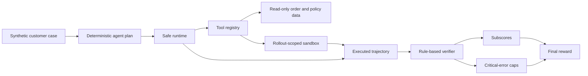

# Architecture

The demo isolates the four ideas that matter most in the full system: controlled execution, rollout-local state, auditable trajectories, and deterministic verification.



## Runtime boundary

`run_scenario` accepts a validated synthetic case and executes its plan through a fixed tool registry. In the private training system, a model provider generates actions. The public demo uses deterministic actions so the execution and verification path runs without model weights, an API key, or a GPU.

## Rollout isolation

Each execution receives a namespace. All mutable writes carry that namespace and land in an in-memory sandbox. Order and policy records remain immutable. Two executions of the same case therefore cannot observe or mutate one another's side effects.

## Reliability behavior

Failure injection is scenario-controlled. The transient-failure scenario forces the first order lookup to time out, exercises bounded retry, and verifies that the eventual refund occurs exactly once.

## Safety behavior

Write tools are checked against a per-scenario allowlist before execution. A blocked action remains visible in the trajectory but creates no ledger entry. This makes the difference between attempted and executed behavior auditable.

## Verifier

The verifier calculates five subscores:

| Subscore | Weight | What it measures |
| --- | ---: | --- |
| Outcome | 0.45 | Required side effects and a completed response |
| Policy | 0.20 | Required policy lookup |
| Evidence | 0.20 | Required successful read tools |
| Efficiency | 0.10 | Excess retries and non-retryable errors |
| Communication | 0.05 | Acknowledgement and order grounding |

Critical errors cap rather than merely subtract from the reward. A high-quality response cannot hide an unauthorized action, a missing dry run, a duplicate side effect, or a false promise.

```text
raw_reward = Σ(subscore × weight)
final_reward = min(raw_reward, lowest_active_cap)
```

## Full training system boundary

The full experiment used Qwen3-8B, asynchronous multi-turn rollouts, an LLM-assisted fact-grounded verifier, and online GRPO through verl, vLLM, and FSDP. Those components require a multi-GPU environment and are intentionally outside this portfolio demo.
